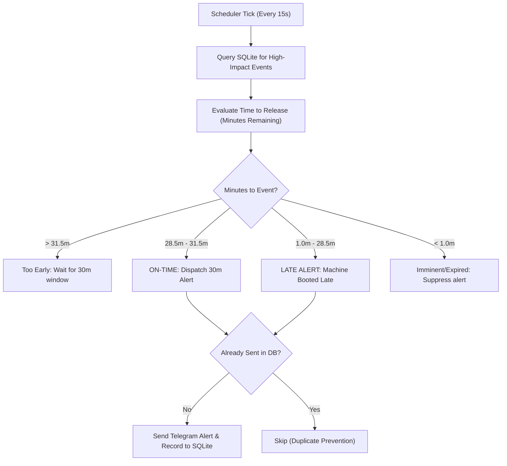

# BANDI — Automated Trading Intelligence & Economic Alert Platform

**BANDI** is a local-first automated trading intelligence and economic news alert platform built specifically for Windows 10 (optimized for lightweight hardware: Intel Core i3, 4 GB RAM).

It delivers precision 30-minute high-impact economic alerts to Telegram, conducts deterministic macroeconomic research across major forex pairs, gold, and equity indices, integrates natively with MetaTrader 5 via a custom MQL5 Expert Advisor, and provides an ultra-responsive web dashboard with zero paid subscriptions or external AI API dependencies.

---

## 1. Core Capabilities

- **Zero-Cost & Local-First**: Runs entirely on local hardware with zero paid economic calendar subscriptions, zero paid AI APIs, zero cloud database costs, and zero paid hosting.
- **Precision 30-Minute Alerts**: High-frequency scheduler continuously scans SQLite records and dispatches alerts to Telegram exactly 30 minutes before tier-1 releases.
- **Audited Duplicate Prevention**: Persistent SQLite records with strict unique constraints ensure alerts are never duplicated across restarts.
- **Late-Alert Recovery Policy**: If the machine boots during the 30-minute pre-event window, BANDI dispatches a clearly marked late alert rather than pretending it was delivered on time.
- **Display & Timezone Accuracy**: Standardized display in **Africa/Johannesburg (SAST, UTC+2)** with all internal events stored strictly in UTC.
- **MetaTrader 5 Native Bridge**: Auto-locates `MetaEditor64.exe`, compiles `Bandi.mq5` into `Bandi.ex5` across all local MT5 instances, and streams live bid/ask/spread telemetry.
- **Deterministic Risk Manager**: Hard-coded safety lock enforcing read-only execution by default; cannot be overridden.
- **Lightweight Responsive Dashboard**: Vanilla HTML5/CSS3/JavaScript frontend (<80 KB total footprint, ~30 MB RAM) running on an asynchronous FastAPI backend.

---

## 2. Supported Market Watchlist

BANDI tracks and resolves broker-specific tickers for the following 12 benchmark instruments:

| Standard Symbol | Description | Asset Class | Common Broker Aliases |
|---|---|---|---|
| **EURUSD** | Euro / US Dollar | Forex Major | EURUSD, EURUSDm, EURUSD.a, EURUSDpro |
| **GBPUSD** | British Pound / US Dollar | Forex Major | GBPUSD, GBPUSDm, GBPUSD.a, GBPUSDpro |
| **USDJPY** | US Dollar / Japanese Yen | Forex Major | USDJPY, USDJPYm, USDJPY.a, USDJPYpro |
| **AUDUSD** | Australian Dollar / US Dollar | Forex Major | AUDUSD, AUDUSDm, AUDUSD.a, AUDUSDpro |
| **USDCAD** | US Dollar / Canadian Dollar | Forex Major | USDCAD, USDCADm, USDCAD.a, USDCADpro |
| **USDCHF** | US Dollar / Swiss Franc | Forex Major | USDCHF, USDCHFm, USDCHF.a, USDCHFpro |
| **NZDUSD** | New Zealand Dollar / US Dollar | Forex Major | NZDUSD, NZDUSDm, NZDUSD.a, NZDUSDpro |
| **XAUUSD** | Gold / US Dollar | Commodities | XAUUSD, GOLD, XAUUSDm, GOLDm |
| **US30** | Dow Jones Industrial Average | Equity Index | US30, DJ30, WallStreet30, US30Cash |
| **NAS100** | Nasdaq 100 Index | Equity Index | NAS100, USTEC, US100, NDX100 |
| **SPX500** | S&P 500 Index | Equity Index | SPX500, US500, SP500, US500Cash |
| **GER40** | DAX 40 Germany | Equity Index | GER40, DE40, DAX40, GER30, DE30 |

---

## 3. Quick Start (Windows)

### Option A: One-Click Batch Scripts
1. Double-click `install.bat` to install dependencies, initialize the database, compile `Bandi.mq5`, and sync the calendar.
2. Double-click `start.bat` to launch the BANDI server and precision alert engine.
3. Open your browser at:
   ```
   http://127.0.0.1:8000
   ```
4. To stop the application cleanly, run `stop.bat`.

### Option B: PowerShell
```powershell
.\install.ps1
.\start.ps1
```

---

## 4. Telegram Bot Setup Guide

Follow these steps to connect your Telegram account to BANDI:

1. **Open Telegram** and search for `@BotFather`.
2. Send `/newbot` and follow the instructions to choose a name and username (e.g. `Bandi_Alert_Bot`).
3. BotFather will provide an HTTP API token (e.g. `1234567890:ABCdefGhIJKlmNoPQRsTUVwxyZ`).
4. Copy this token and set it in your `.env` file:
   ```env
   TELEGRAM_BOT_TOKEN=your_bot_token_here
   ```
5. **Find your Personal Chat ID**:
   - Open Telegram and search for `@userinfobot` or `@RawDataBot`.
   - Send `/start`. The bot will reply with your numerical `Id` (e.g. `1916380095`).
   - Copy this number into your `.env` file:
     ```env
     TELEGRAM_CHAT_ID=your_chat_id_here
     ```
6. **Start Your Bot**:
   - Search for your newly created bot username in Telegram and click **START** (or send `/start`).
   - *Important:* Telegram bots cannot send messages to users who have not initiated a conversation first.
7. **Verify Connectivity**:
   - In terminal, execute:
     ```bash
     python main.py test-telegram
     ```
   - Or click the **🔔 Test Telegram** button on the BANDI web dashboard.

---

## 5. MetaTrader 5 & MQL5 Integration

BANDI compiles and installs an on-chart visual monitor and quote telemetry bridge directly inside MetaTrader 5.

### What Bandi.mq5 Does:
1. Displays an on-chart visual overlay with account balance, equity, live spread, and the next scheduled high-impact release with a countdown timer.
2. Streams live bid/ask/spread telemetry to the local BANDI engine (`http://127.0.0.1:8000/api/mt5/sync`) and offline cache (`MQL5\Files\bandi_telemetry.json`).
3. Enforces read-only safety locks—live order dispatch is locked by default.

### How to Attach to an MT5 Chart:
1. Open MetaTrader 5.
2. In the **Navigator** panel (`Ctrl + N`), expand **Expert Advisors**.
3. Locate **Bandi** under Experts.
4. Drag and drop **Bandi** onto any active chart (e.g., EURUSD or XAUUSD).
5. In the properties dialog, ensure **Allow WebRequest** is enabled if sending HTTP telemetry, or let it sync via local files.
6. The on-chart monitor will immediately display live spread and upcoming economic events.

---

## 6. Precision 30-Minute Scheduler & Late-Alert Policy



### Late-Alert Policy Rules:
- **On-Time Alert**: Dispatched between 28.5 and 31.5 minutes prior to the release.
- **Late Alert**: If BANDI starts after the 30-minute threshold but the event is still 1 to 28 minutes away, it dispatches an alert with an explicit banner: `⚠️ [LATE ALERT — SYSTEM RESTARTED]`.
- **Suppression**: If an event is less than 60 seconds away or has already passed, it is suppressed to prevent stale message spam.

---

## 7. Configuration Variables Reference (`.env`)

| Variable | Default Value | Description |
|---|---|---|
| `APP_NAME` | `BANDI` | Application display identifier |
| `APP_ENV` | `production` | Runtime mode (`development` or `production`) |
| `DEBUG` | `false` | Verbose debug logging toggle |
| `HOST` | `127.0.0.1` | Local IP binding for the dashboard server |
| `PORT` | `8000` | HTTP port for the web dashboard |
| `DATABASE_PATH` | `data/bandi.db` | Relative path to persistent SQLite database |
| `DISPLAY_TIMEZONE` | `Africa/Johannesburg` | Human-facing display timezone (SAST UTC+2) |
| `TELEGRAM_BOT_TOKEN` | *Required* | API token from `@BotFather` |
| `TELEGRAM_CHAT_ID` | *Required* | Telegram user/group ID for alerts |
| `TELEGRAM_ENABLED` | `true` | Master switch for Telegram alerts |
| `CALENDAR_API_URL` | `https://showmytrades.com/api/public/calendar/v1` | Free public economic calendar endpoint |
| `CALENDAR_POLL_INTERVAL_MINUTES` | `15` | Minimum remote polling interval (enforced >= 15m) |
| `ALERT_MINUTES_BEFORE` | `30` | Nominal alert lead time in minutes |
| `MT5_TERMINAL_PATH` | `C:\Program Files\JustMarkets MetaTrader 5\terminal64.exe` | Path to MT5 terminal executable |
| `MT5_METAEDITOR_PATH` | `C:\Program Files\JustMarkets MetaTrader 5\MetaEditor64.exe` | Path to MetaEditor for MQL5 compilation |
| `RISK_MAX_DAILY_DRAWDOWN_PCT` | `3.0` | Maximum daily portfolio drawdown threshold (%) |
| `RISK_MAX_OPEN_POSITIONS` | `5` | Maximum allowable concurrent open positions |
| `RISK_MAX_SPREAD_POINTS` | `30` | Spread expansion filter threshold (points) |
| `RISK_TRADING_LOCKED` | `true` | Enforces read-only safety mode (cannot be overridden by AI) |

---

## 8. Troubleshooting

- **Telegram Message Not Delivered**:
  - Verify that you have started a private conversation with your bot by clicking `/start`.
  - Verify that your token and chat ID in `.env` are accurate. Run `python main.py test-telegram`.
- **Calendar Returns 0 Events**:
  - The calendar API default query covers the next 24 hours. On weekends (Saturday/Sunday), scheduled events are minimal. BANDI automatically queries with `?days=7` to ingest the entire upcoming week.
- **MT5 EA Compilation Failed**:
  - Verify the path to `MetaEditor64.exe` in `.env`.
  - Ensure MetaTrader 5 has run at least once so its profile directories in `%APPDATA%\MetaQuotes\Terminal` exist.
- **Port 8000 Already in Use**:
  - Run `stop.bat` or `.\stop.ps1` to terminate lingering server processes, or adjust `PORT=8001` in `.env`.
